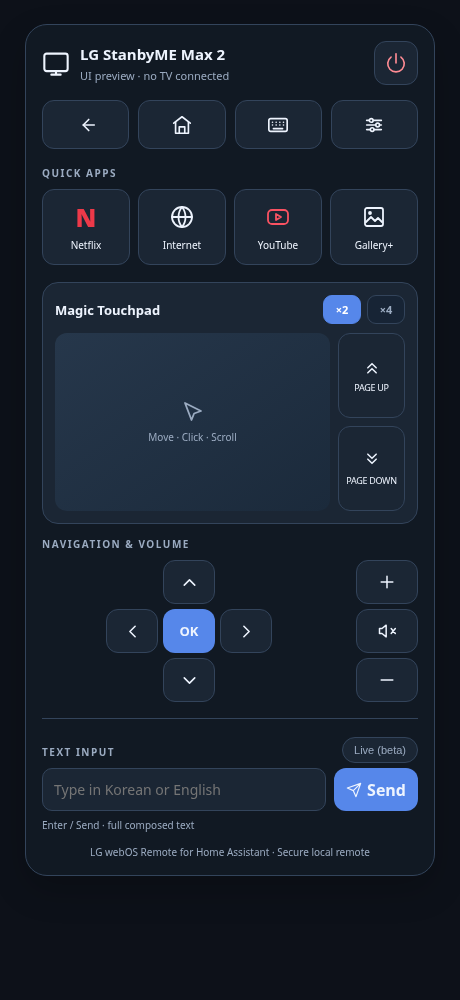

# LG webOS Remote for Home Assistant

**v1.0.0 — first public release (MIT).**

Custom Home Assistant remote for LG webOS TVs: Wake-on-LAN power-on, power-off, dedicated pointer connection, swipe/click/scroll, Page Up/Down, Back/Home/Settings, app shortcuts, volume, D-pad and an English/Korean text field.

> Community project. Not affiliated with or endorsed by LG Electronics or Home Assistant. Device support varies with model and firmware. Not all features are validated across TV models and apps; no formal security audit has been performed.



*UI preview with sample configuration; no TV or private credentials are shown.*

## Features

- **Remote UI:** icon-only Back, Home, Keyboard and Settings, Power at top-right; Netflix, Internet, YouTube, and Gallery+ shortcuts (based on installed apps), D-pad + OK and vertical volume buttons.
- **Magic touchpad:** cursor movement, click, mouse wheel, two-finger scroll, Page Up/Down and ×2/×4 pointer sensitivity.
- **Text entry:** one-line text field and Send / Enter; optional Live (beta) text sync. LG browser accepts IME input on tested hardware; Netflix/YouTube may **not** accept external text injection.
- **Power:** Wake-on-LAN (requires enabled support and correct TV MAC), plus webOS power-off.
- **Bridge:** dedicated persistent LG pointer session, local token authentication, first-frame auth with a randomly generated secret. No reliance on the CC BY-NC-ND Lovelace Touchpad Card.

## Installation for users

This package has **two independently installed parts**: a HACS Dashboard card and a Home Assistant **app** (TV bridge). For installation, add this GitHub repository as a *custom repository*. It is not yet listed in the default HACS catalog.

### 1. Install LG webOS Remote Bridge app

Go to **Settings → Apps → Install app** and add this repository URL as a custom Home Assistant app repository; install **LG webOS Remote Bridge**. The repository has `repository.yaml` and `lg_webos_remote/config.yaml` in the expected layout. See [Home Assistant app repository docs](https://developers.home-assistant.io/docs/apps/repository/).

In the app config enter your own TV IP address, Wi-Fi MAC address, port (default `8788`), broadcast address, and a fresh random authentication token **at least 40 characters long**. Example token generation on a device with Python:

```sh
python3 -c 'import secrets; print(secrets.token_urlsafe(32))'
```

This token must remain secret. Start the app while the TV is awake and approve pairing on the TV if prompted. Rebuild the app after changing its source code; a normal restart does not rebuild the image.

### 2. Install the dashboard card via HACS

In HACS, select **Custom repositories**, paste the same GitHub URL, and select **Dashboard**. Download the card. HACS looks for `ha-webos-remote.js` because the repository is named `ha-webos-remote`. See [HACS Dashboard publication rules](https://www.hacs.dev/docs/publish/plugin/).

If HACS does not register the resource automatically, in **Settings → Dashboards → Resources** add `/hacsfiles/ha-webos-remote/ha-webos-remote.js` as a **JavaScript module**. Restart or reload your dashboard as needed.

Add a **Manual card**:

```yaml
type: custom:lg-webos-remote
name: Living Room TV
url: ws://YOUR_HOME_ASSISTANT_IP:8788
token: YOUR_PRIVATE_RANDOM_TOKEN
sensitivity: 1
scrollSensitivity: 1
```

**Never publish your real `token:` or full dashboard YAML without redaction.** `ws://` is unencrypted; use a trusted LAN only. No internet port forwarding.

### Upgrade from an existing local installation

If you already installed the pre-GitHub local app and want to preserve its settings and pairing: follow [Upgrade from Alpha 5](docs/UPGRADE_FROM_ALPHA5.md). Do **not** uninstall the existing local app just to switch installation sources; first verify data migration and create a backup. The local app slug and the GitHub repository app may have different installation identities.

## Development

```sh
npm run build
npm run verify
python3 -m py_compile lg_webos_remote/*.py
python3 scripts/package.py
```

Requires Node.js 22+ and Python 3.13+ for development. The card has no runtime npm dependencies; the app installs pinned Python requirements. Tests do not require a TV, but **real LG hardware testing is required** for pairing, app discovery, cursor behavior, power, scrolling and IME functionality.

Before running these commands, create an isolated Python environment and install the bridge and test dependencies:

```sh
python3 -m venv .venv
. .venv/bin/activate
python -m pip install -r lg_webos_remote/requirements.txt pyyaml
```

Release packaging requires Git and includes only tracked repository files. Stage new public source files before running `scripts/package.py`; ignored and untracked local files are excluded. Never stage private configuration or credentials.

## Troubleshooting and compatibility

- **Invalid token:** use the same random 40+ character token in the Bridge app options and dashboard card. Never paste it into a public issue.
- **TV offline:** Power sends Wake-on-LAN without requiring a TV connection. Check the configured Wi-Fi MAC, network connectivity, and TV remote power-on settings.
- **Pairing:** keep the TV awake and approve its Allow prompt. The private key is stored in `/data/webos-client-key.json` and reused across app restarts. Preserve the app data volume when updating. See [safe local upgrades](docs/UPGRADE_FROM_ALPHA5.md).
- **Pointer unavailable:** rebuild the Bridge after a code update. `pointer_session.py` must be in the image; the pointer uses its own persistent connection. Avoid running the older port-8777 Bridge during diagnostics.
- **Text rejected:** focus a compatible TV text field first. English and Korean insertion worked in the development device's browser; Netflix and YouTube may reject external input. Live is experimental.
- **Card does not update:** check the HACS resource URL, reload the dashboard, and follow the [publishing and installation guide](docs/PUBLISHING.md).
- **Secure Home Assistant page:** an HTTPS dashboard may block plain `ws://` as mixed content. Use a correctly configured trusted WSS proxy; native TLS termination is not included in the Bridge.

### Validation scope

Development testing on one LG StanbyME Max 2 confirmed pairing, full-screen pointer movement, click, power-on/off, and English/Korean browser input. This is historical hardware evidence, not a claim that this release was retested on hardware during publication.

Automated checks cover authentication and invalid commands over a real local WebSocket, offline WOL dispatch, pointer registration/session reuse, pairing-key persistence, message payloads, version consistency, and ZIP contents. Long-running TV stability, app-specific scrolling and Page buttons, other TV models, fresh HACS/HAOS installations, and Live text in Netflix/YouTube require further device testing. See [security limitations](SECURITY.md) and the [roadmap](docs/ROADMAP.md).

## Publish on GitHub

See [Publishing guide](docs/PUBLISHING.md) for the repository, CI/HACS validation, creating GitHub releases and the separate Home Assistant installation paths. [Changelog](CHANGELOG.md), [contributing](CONTRIBUTING.md), [security](SECURITY.md), [third-party notices](NOTICE.md).

## Licensing

Project sources are distributed under the [MIT license](LICENSE). `bscpylgtv` is MIT-licensed; `websockets` uses BSD-3-Clause (see NOTICE.md). This package was independently written; it does not contain code from the separately licensed `michalowskil/lovelace-touchpad-card` project. No formal legal or security audit has been performed.
